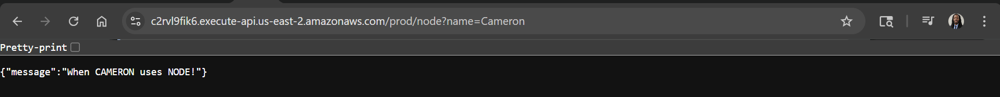
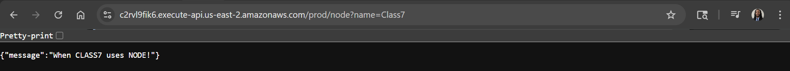
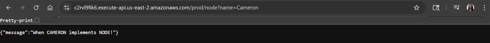
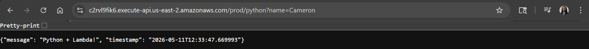
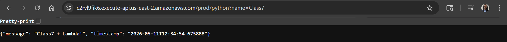
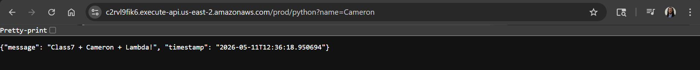
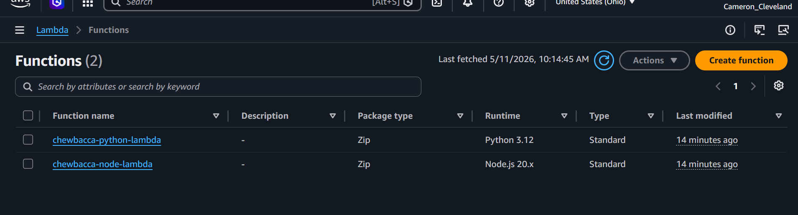
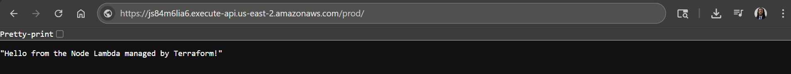
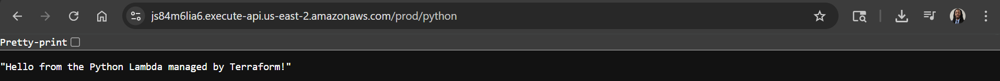

# 🚀 API Gateway & Lambda Integration (ClickOps vs. Terraform)

## 🎯 Objective
The goal of this lab was to deploy and secure serverless endpoints using two distinct methods: **Manual ClickOps** (to understand resource relationships) and **Terraform** (to practice scalable, repeatable deployments). This project demonstrates the integration of AWS Lambda with both HTTP and REST API Gateway protocols.

---

## 🛠️ Part 1: Practice (ClickOps)
I manually provisioned an API Gateway and integrated it with two backend Lambdas: one running **Node.js 20.x** and one running **Python 3.12**.

### 📸 Execution Evidence (6 Unique Responses)
To verify the dynamic nature of the integration, I passed unique name parameters to the endpoints.

#### Node.js Endpoint:
* **Param: Cameron** 
* **Param: Class7** 
* **Param: Cameron Implements** 

#### Python Endpoint:
* **Param: Cameron** 
* **Param: Class7** 
* **Param: Class7 + Cameron** 

---

## 💻 Part 2: Practice (Terraform)
I codified the infrastructure to automate the deployment of the API Gateway, Lambda functions, and the necessary IAM permissions.

### 📸 Terraform Evidence
* **Provisioned Functions:** 
* **Node Deployment:** 
* **Python Deployment:** 

---

## 🛡️ Defending the Code (Key Arguments)
As a transitioning **DevSecOps Engineer**, I can defend the following core arguments used in my `.tf` files:

| Argument | Purpose | Defense |
| :--- | :--- | :--- |
| `principal = "apigateway.amazonaws.com"` | Security/Trust | Implements **Least Privilege** by ensuring only API Gateway can invoke the Lambda, preventing unauthorized triggers. |
| `handler = "index.handler"` | Operational | Points to the entry function; vital for ensuring the runtime knows exactly where to start execution. |
| `runtime` | Performance | Used **Node.js 20.x** and **Python 3.12** for the latest LTS security patches and performance optimizations. |
| `source_arn` | Granular Security | Restricts Lambda invocation to a specific API Gateway ARN rather than any API in the account. |

---

## 🧠 Key Takeaways
* **ClickOps vs. Code:** Manual deployment was essential for understanding how `lambda_permission` resources bridge the gap between the API and the code.
* **Multi-Runtime Support:** Successfully managed both Node and Python environments within the same Terraform module, demonstrating a polyglot architectural approach.
* **Automation:** Terraform ensures that the `aws_api_gateway_deployment` resource triggers a new version of the API whenever integration changes.

---

### 🏁 Final Cleanup
1. Executed `terraform destroy` to remove all IAM roles, Lambda functions, and API stages.
2. Verified the console is clear of lab-related resources.